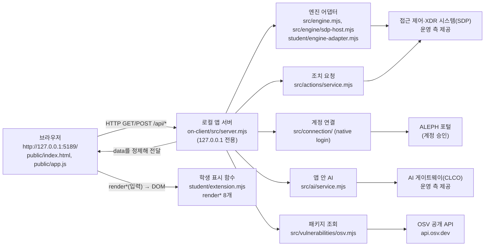

# 케셰브 학생 실행 설명서와 시스템 구성도

이 문서는 학생이 직접 작성했습니다. 제공 문서(`docs/GETTING_STARTED_STUDENT.md`, `docs/STUDENT_LAUNCH_GUIDE.md`, `docs/CONNECTION_TROUBLESHOOT.md` 등)는 수정하지 않았고, 이 문서에는 **이 프로젝트에서 실제로 실행해 확인한 것**과 **확인하지 못한 것**을 구분해 적었습니다. 확인 일자는 2026-10-23입니다.

## 1. 목적과 기능

- **목적**: 회사 직원이 자기 로그인 상태·기기·세션, 업무 앱 접속 판정, 보안 기록, 설치 패키지의 알려진 취약점 조회 결과, 앱 안 AI 설명, 보안 조치 요청 상태를 한 화면에서 보는 보안 Agent 앱 「케셰브」입니다. 실제 보안 조치를 집행하는 앱이 아니라, 제공 서버가 가져온 결과를 **정확히 구분해 표시**하는 앱입니다.
- **학생이 만든 것**: `on-client/student/extension.mjs`의 화면 표시 함수 8개(아래 6장).
- **제공된 것**: 로컬 서버 `src/server.mjs`, 화면 `public/`, 연결 모듈 `src/`, 실행 도구 `tools/start-alekov.ps1`.

## 2. 필요한 프로그램과 확인한 버전

| 항목 | 요구 | 이 PC에서 확인한 값 |
|---|---|---|
| Node.js | 수업 기준 24.19.0 (`package.json`의 `engines.node`). 실행 도구 안내는 22~24 | `v24.19.0` (`node -v`) |
| npm | `npm start`·`npm run check` 실행용 | `11.17.0` (`npm -v`) |
| PowerShell | 실행 도구 `tools/start-alekov.ps1` 실행용 | Windows PowerShell 5.1 |
| OS | Windows | Windows 11 Pro 10.0.26100 |
| 외부 npm 패키지 | 없음 | `package.json`에 `dependencies` 항목 없음, `npm install` 불필요 |
| 브라우저 | 로컬 주소를 여는 PC 브라우저 | 브라우저 화면은 이 문서 작성 중 열어 보지 않았고, HTTP 요청으로 `/` 응답 200만 확인(화면 표시는 **미확인**) |

지원하지 않거나 확인하지 않은 환경: Node.js 21 이하와 25 이상, macOS·Linux(실행 도구가 PowerShell 스크립트이며 이 PC에서 시험하지 않음) — **미확인**.

## 3. 폴더 구조

작업 위치는 Git 최상위인 프로젝트 폴더 `project5`이고, 13~22단계 앱은 그 안의 `on-client` 폴더입니다.

```
project5/                         ← Git 최상위 (커밋·제출은 여기 기준)
├─ README.md                      ← 학생 작성 단계 기록과 요약
├─ aleph.config.json, api/, src/  ← 1~12단계 과제(Vercel 배포 앱)
└─ on-client/                     ← 13~22단계 앱 폴더 (PowerShell을 여는 위치)
   ├─ package.json                ← start / demo / check 스크립트
   ├─ .env.example                ← 비밀 없는 설정 견본
   ├─ student/extension.mjs       ← 학생 구현 (renderIdentity … renderAction)
   ├─ student/engine-adapter.mjs  ← 제공 어댑터 틀
   ├─ tools/start-alekov.ps1      ← 제공 실행 도구
   ├─ src/server.mjs              ← 제공 로컬 서버 (127.0.0.1 전용)
   ├─ src/engine.mjs, src/engine/ ← 기존 엔진·SDP 연결 모듈
   ├─ src/connection/             ← 계정 연결(native login)
   ├─ src/ai/, src/learner-support/ ← 앱 안 AI 연결·도움
   ├─ src/actions/                ← 조치 요청 서비스
   ├─ src/vulnerabilities/        ← OSV 패키지 조회
   ├─ public/                     ← 브라우저 화면 (index.html, app.js 등)
   └─ docs/                       ← 제공 문서 + 이 학생 문서
```

## 4. 실행·확인·종료·재실행

### 4.1 PowerShell을 여는 위치

파일 탐색기에서 `project5\on-client` 폴더를 열고 주소 표시줄에 `powershell`을 입력해 Enter를 누릅니다. 이미 PowerShell이 열려 있다면 프로젝트 폴더에서 `cd on-client`로 이동합니다. 실행 도구는 이 폴더가 아니면 `앱 폴더가 아닙니다`라는 안내를 내고 멈춥니다.

### 4.2 실행 명령 (실제 확인한 것)

| 목적 | 명령 (앱 폴더 `on-client`에서) | 확인 결과 |
|---|---|---|
| 기본 실행 | `powershell -NoProfile -ExecutionPolicy Bypass -File .\tools\start-alekov.ps1` | 포트 5191로 바꾸어 실행해 시작 신호와 응답을 확인했습니다. 다른 작업과 겹치지 않게 5191을 골랐으며 기본 포트 5189로는 시험하지 않았습니다(**미확인**). |
| 포트 변경 | `... start-alekov.ps1 -Port 5191` | 정상 시작 확인 |
| 창 없이 실행 | `... start-alekov.ps1 -Background` | 시작 후 프로세스 번호가 안내됨, 해당 node 프로세스 종료로 중지 확인 |
| 예제 자료 실행 | `npm run demo` (프로젝트 폴더에서는 `npm --prefix on-client run demo`) | 서버 시작 안내와 `/` 응답 200, `/api/me`가 예제 사용자 반환을 확인. 실제 연결이 아님 |
| 문법 검사 | `npm --prefix on-client run check` | `student/extension.mjs` 문법 오류 없음 |

`npm start`(`node src/server.mjs`)도 같은 서버를 켜지만 Node 버전·포트를 미리 확인하지 않습니다. 이 PC에서 `npm start`는 따로 실행하지 않았습니다(**미확인**).

### 4.3 브라우저 주소와 정상 시작 신호

- 주소: `http://127.0.0.1:5189/` (포트를 바꿨다면 그 포트). 서버는 `127.0.0.1`에만 열리며 다른 PC에서는 접속되지 않습니다.
- 정상 시작 신호(실행 도구 출력 세 줄, 이번 시험에서 같은 내용을 확인): ① 앱이 켜졌고 브라우저에서 열 주소 안내 ② 서버가 응답한 것만 확인했고 AI 연결 상태는 화면에서 따로 확인하라는 안내 ③ `-Background`일 때 프로세스 번호 안내.
- 서버 응답 확인: `/` → HTTP 200(14,464바이트). `/api/vulnerabilities` → `status: not_configured`, `meta.mode: disconnected`. 이는 **정상**이며 "취약점 없음"이 아니라 "조회 대상 프로젝트 설정 없음"입니다.
- 기본 실행은 실제 회사 시스템(SDP)·AI 게이트에 연결되지 않은 `disconnected` 상태입니다. 연결 설정 파일은 운영자가 안내한 경로만 `-NativeHostConfig`, `-SdpHostConfig` 옵션으로 넘깁니다. 이 PC에서는 두 설정을 사용하지 않았습니다.

### 4.4 종료와 재실행

- 종료: 서버를 실행한 PowerShell 창에서 `Ctrl+C`. `-Background`로 켰다면 안내된 프로세스 번호의 node를 작업 관리자(또는 `Stop-Process -Id <번호>`)로 종료합니다. 종료 뒤 같은 주소가 응답하지 않는 것을 확인했습니다.
- 재실행: 같은 폴더에서 4.2의 명령을 다시 실행합니다. 실행과 종료는 프로젝트 파일을 바꾸지 않습니다. 포트 충돌이면 실행 도구가 다른 프로그램을 종료하지 않고 안내만 하므로 `-Port`로 바꿉니다.

## 5. 시스템 구성도 (글)

### 5.1 Mermaid



### 5.2 같은 내용의 표

| 구간 | 주고받는 것 | 실제 파일 | 이 PC에서 확인 |
|---|---|---|---|
| 브라우저 → 로컬 앱 서버 | `GET /api/me, /api/apps, /api/events, /api/devices, /api/sessions, /api/diagnostics, /api/vulnerabilities`, `POST /api/access, /api/ai/check, /api/ai/explain, /api/actions/prepare, /api/actions/execute, /api/actions/result, /api/learner-support` | `public/app.js`, `src/server.mjs` | `/`, `/api/vulnerabilities`, `/api/me`(예제)만 확인 |
| 로컬 앱 서버 → 학생 표시 함수 | 응답 상태(`status`·`mode`·`data`·`error`) | `public/app.js`가 `student/extension.mjs`의 함수를 호출 | 모의 입력으로만 확인(7장) |
| 로컬 앱 서버 → 접근 제어·XDR(SDP) | 본인·기기·세션·업무 앱 판정·보안 기록, 조치 | `src/engine/sdp-host.mjs`, `src/actions/` | **미확인**(SDP 설정 파일 없음) |
| 로컬 앱 서버 → ALEPH 포털 | 계정 연결 확인 | `src/connection/` | **미확인** |
| 로컬 앱 서버 → AI 게이트웨이 | 연결 점검, 사건 설명 | `src/ai/service.mjs` | **미확인**(앱 권한 준비 여부 확인 불가) |
| 로컬 앱 서버 → OSV | 정확한 설치 버전 조회, 운영자 허용 패키지만 | `src/vulnerabilities/` | **미확인**(허용 목록 `[]`이라 조회 없음) |

## 6. 구현한 함수와 제공 코드의 경계

| 함수 (`student/extension.mjs`) | 단계 | 맡은 일 | 제공 코드가 하는 일 |
|---|---|---|---|
| `renderIdentity` | 13 | 사용자·기기·세션 표시 | 데이터 조회·상태 전달 |
| `renderDecision` | 14 | 업무 앱 접속 판정 표시 | 판정 요청 |
| `renderEvents` | 15 | 보안 기록 목록·상세 표시 | 기록 조회 |
| `renderStatus` | 16 | 상태 진단·미지원 조치 표시 | 진단 조회 |
| `renderAiConnection` | 17 | AI 연결 점검과 오류 구분 표시 | 연결·승인 절차, 점검 요청 |
| `renderExplanation` | 18 | 근거·규칙·상태와 AI 요약 표시 | AI 요청, 근거 ID 검사 |
| `renderAction` | 19 | 조치 제안·접수·효과 확인 구분 표시 | 준비·집행·재조회 버튼과 요청 |
| `renderVulnerabilities` | 20 | 설치 버전별 OSV 조회 결과 표시 | 패키지 조회 요청 |

학생 함수는 표시만 합니다. 조치 버튼·서버 요청·인증 티켓·열쇠 입력은 만들지 않았고, `public/app.js`·`src/`·인증 설정은 수정하지 않았습니다.

## 7. 확인한 기능과 확인하지 못한 기능

| 항목 | 상태 | 근거 |
|---|---|---|
| 실행 도구로 서버 시작(포트 5191), `/` 응답 200 | **확인함** | 2026-10-23 실제 실행 |
| `/api/vulnerabilities` = `not_configured`, `disconnected` | **확인함** | 같은 실행에서 응답 읽음 |
| 예제 모드(`demo`) 시작과 `/api/me` 응답 | **확인함** | 포트 5192로 실행 후 종료 |
| 서버 종료 뒤 응답 없음 | **확인함** | 종료 후 요청 시 연결 실패 |
| 학생 함수 문법 검사(`npm run check`) | **확인함** | 오류 없음 |
| 학생 함수의 상태별 표시 | **모의 DOM 입력으로만 확인** | 합성 데이터 검사(18단계 13개, 19단계 18개, 20단계 13개 통과). 실제 응답이 아님 |
| 기본 포트 5189 실행, `npm start` | **미확인** | 이 문서 작성 중 시험하지 않음 |
| 계정 연결, AI 앱 승인, AI 연결 점검 성공, 사건 설명 성공 | **미확인** | 운영 측 권한 준비 여부를 확인할 수 없음 |
| 조치 준비·집행·결과 재조회 | **미확인** | 현재 기록의 `supportedActions`가 비어 있어 버튼이 나오지 않는 것이 정상, 집행은 시험하지 않음 |
| 실제 OSV 조회 | **미확인** | 허용 패키지 목록이 비어 있음 |
| 실제 SDP(접근 제어·XDR) 연결 | **미확인** | 설정 파일 없음 |
| 화면 버튼 이름 일치 | **일부 불일치** | 화면의 재조회 버튼은 「원천 결과만 재조회」(`public/index.html`)인데 학생 함수 안내 문구는 공식 안내의 이름 「연동 시스템 결과만 재조회」를 씁니다. 같은 버튼을 가리킵니다 |

## 8. 문제가 생겼을 때 확인 순서

각 표의 첫 열은 실제 화면·서버 메시지입니다. 더 많은 코드는 제공 문서 `docs/CONNECTION_TROUBLESHOOT.md`에 있습니다.

| 증상·메시지 | 원인 | 학생이 확인할 순서 | 다시 시도 |
|---|---|---|---|
| `Node.js 가 없습니다` / `지금 Node.js 는 vXX` | Node 없음 또는 지원 밖 버전 | ① `node -v` ② 22~24(기준 24.19.0)인지 확인 ③ 설치 후 PowerShell 새 창 | 설치 뒤 |
| `포트 5189 를 다른 프로그램이 쓰고 있습니다` | 포트 충돌 | ① 그 프로그램은 종료하지 않음 ② `-Port 5190`으로 실행 ③ 브라우저 주소도 같은 포트로 | 바로 |
| `앱 폴더가 아닙니다` / `시작 틀 폴더가 아닙니다` | 실행 위치 오류 | `on-client` 폴더 안인지, 바로가기 폴더가 아닌지 | 위치 수정 뒤 |
| `…초 안에 뜨지 않았습니다` | 서버가 제때 응답 안 함 | 창의 메시지 전체를 보관하고 `-WaitSeconds 30`으로 재시도, 계속되면 강사에게 | 원인 확인 뒤 |
| 화면 상태 `disconnected`(연결 없음) | 이 실행에 연결 설정 없음 | 정상 기본값. 실제 연결이 필요하면 운영자가 준 설정 경로를 옵션으로 지정 | 설정 받은 뒤 |
| `ON_AI_PROVISIONING_PENDING`(권한 준비 중) | 계정 연결·앱 권한 준비 전 | ① 계정 연결 확인과 AI 앱 승인을 마쳤는지 ② 학생 코드 문제가 아님 ③ 담당자에게 앱 권한 확인 요청 | 운영자 준비 뒤 |
| `WB_CLCO_RATE_LIMITED`, `…_TIMEOUT`, `…_NETWORK_ERROR` | 요청 제한·시간 초과·네트워크 | 잠시 기다린 뒤 제공 화면의 버튼을 직접 누름. 자동 재시도 없음 | 잠시 뒤 직접 |
| 패키지 조회 `not_configured` / `not_checked` | 조회 대상 설정·허용 목록 없음 | 정상 상태. "취약점 없음"이 아님. 설정은 운영자가 준비 | 운영자 준비 뒤 |
| 조치 결과 `unknown`(결과 불명) | 접수는 됐지만 효과를 확인하지 못함 | 성공·효과 없음으로 판단하지 않고, 제공 화면의 결과 재조회 버튼만 직접 누름. 같은 조치를 다시 집행하지 않음 | 재조회 |

## 9. 비밀값과 제출 제외

- 설정 견본 `on-client/.env.example`에는 `ON_PORT`, `ON_ENGINE_ADAPTER`, `ON_AI_MODEL`, `ON_PROJECT_DIRECTORY`, `ON_APPROVED_PUBLIC_PACKAGES`처럼 **비밀 없는 이름과 기본값**만 있습니다. 실제 값이 필요하면 `.env`에 두며, `on-client/.gitignore`의 `.env`·`.env.*` 규칙으로 Git에서 제외됩니다(`git check-ignore`로 `on-client/.env`가 제외됨을 확인).
- 키·토큰·비밀번호·SDP 개인 설정·인증서는 이 문서, 코드, 커밋에 적지 않았습니다. 이 문서의 주소는 로컬 주소(`127.0.0.1`)와 공개 도메인(`api.osv.dev`)뿐입니다.

## 10. 제출 순서 (21·22단계)

1. 이 문서와 단계 코드를 같은 커밋에 저장합니다. 이미 준비 중인 다른 변경(예: `xdr/` 작업)은 내용을 확인하고 포함하지 않거나 따로 보존합니다.
2. 과제 화면에 저장소 주소와 **40자리 커밋**을 직접 입력합니다.
3. 비공개 커밋이면 과제 화면의 「비공개 저장소 원문 준비 방법」에서 「원문 전달 도구 받기」로 받은 `student-source-cli.mjs`를 사용합니다. 명령의 도구·출력 파일 경로와 `--commit` 값은 과제 화면 안내를 따르며, 이 문서에는 **추측한 명령을 적지 않았습니다**.
4. 생성된 JSON을 같은 단계의 「비공개 저장소 원문 묶음」에서 선택해 제출하고, 서버 상태와 판정 설명을 확인합니다.

### 10.1 제출용 축소 브랜치

코드 크기 한도(약 250KB) 때문에 제출은 `main`이 아니라 크기를 줄인 `submission-stage21` 브랜치로 합니다. 이 브랜치에는 이 문서, `README.md`, `on-client/package.json`, `on-client/.env.example`, `on-client/tools/start-alekov.ps1`, `on-client/student/`의 파일, 그리고 화면 파일 `on-client/public/{index.html,app.js,ai-connect.mjs}`, `on-client/src/ai/service.mjs`가 들어 있고, `src/server.mjs`·`src/engine/`·`src/connection/`·`src/actions/`·`src/vulnerabilities/`·`public/style.css`·`public/vulnerabilities-view.mjs`는 **빠져 있습니다**. 빠진 파일의 내용은 `main` 브랜치에 있으며, 3~6장은 `main`의 전체 트리를 기준으로 쓴 설명입니다.
